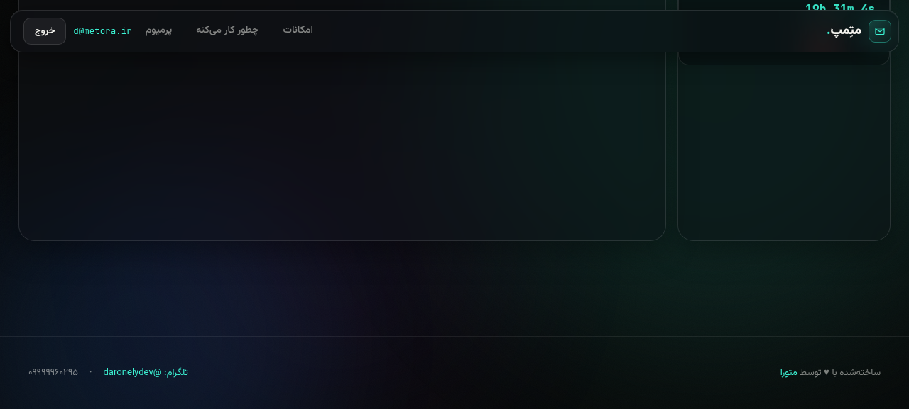
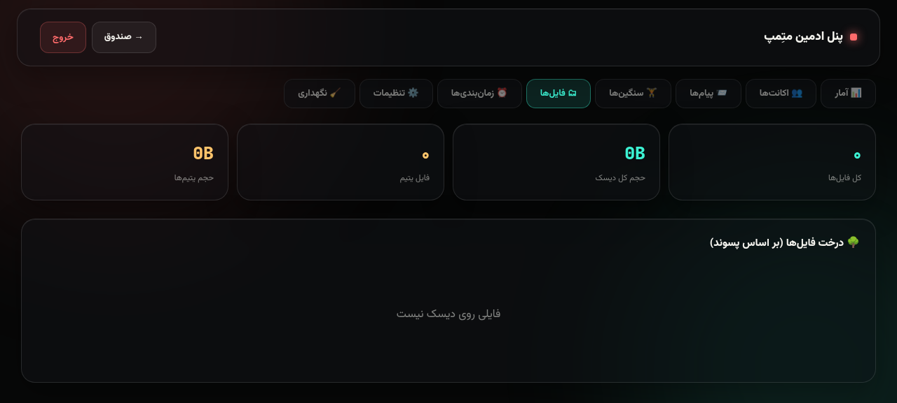
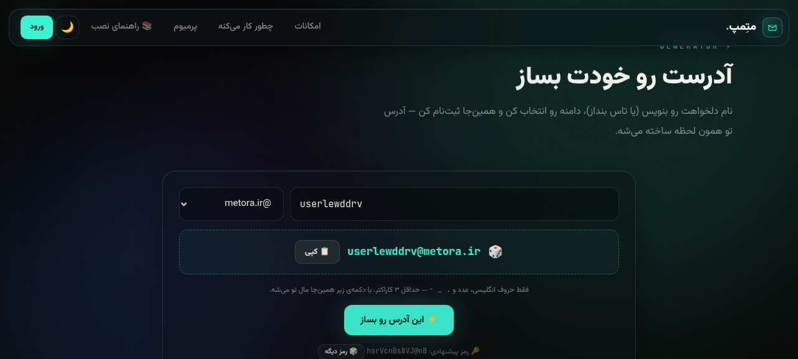
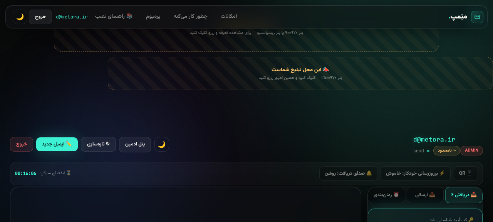
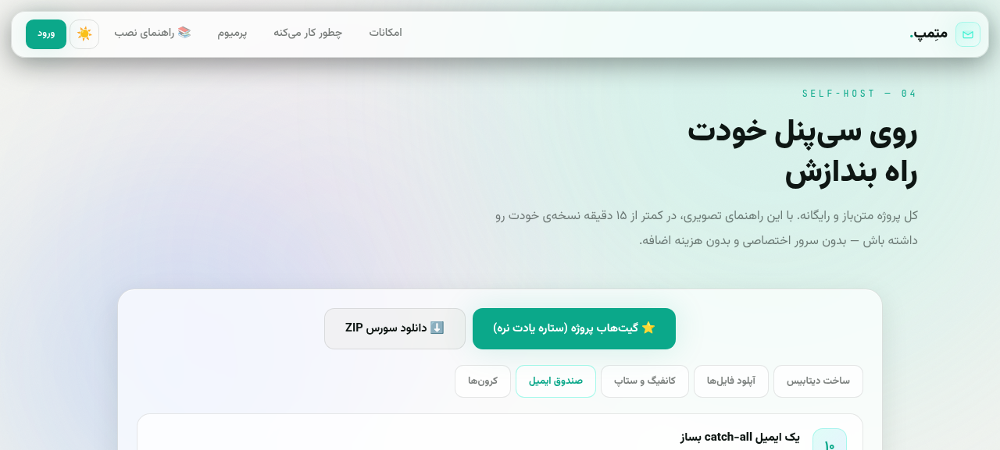
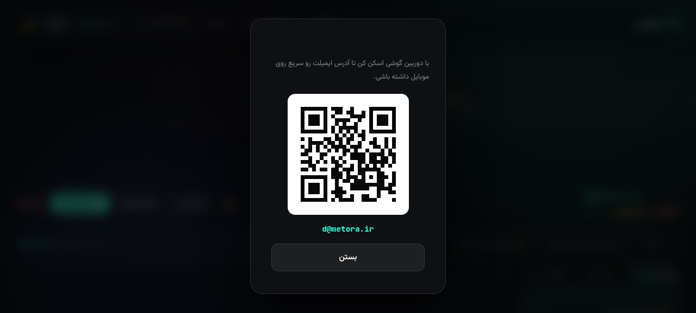
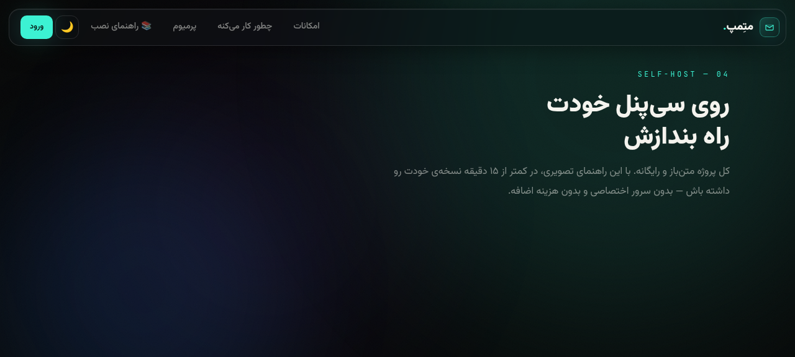
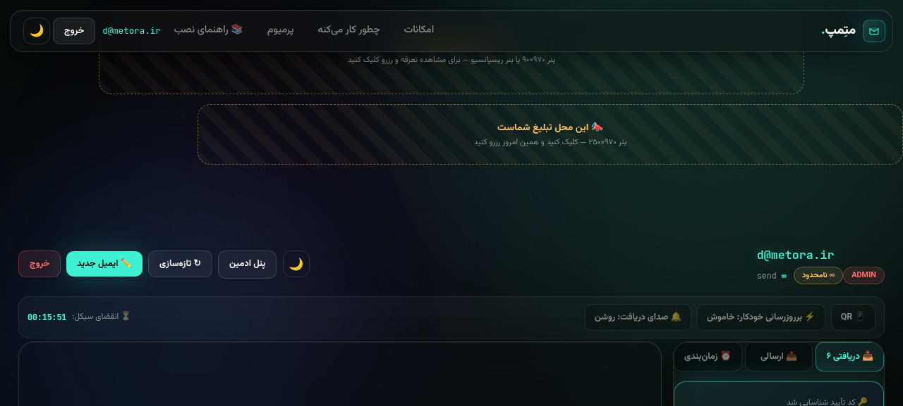

<div align="center">


# ⚡ Metora TempMail

**A disposable email service that actually works** — send, receive, attach, schedule. No spam, no hassle.

[](https://temp.metora.ir)


🌐 **English** · **[فارسی](README.md)** · **[Русский](README.ru.md)**

*A full-featured disposable email service running on an ordinary cPanel shared host — no dedicated server, no cloud services, no framework.*

**[🚀 Live Demo](https://temp.metora.ir)** · **[✨ Features](#-features)** · **[🎨 UI-Effects](#-ui--experience)** · **[📦 Install](#️-cpanel-install-5-minutes)**

</div>

---

## 🎯 Why Metora?

| Feature | Metora | Typical temp-mail |
|:---|:---:|:---:|
| Dedicated `@metora.ir` address | ✅ | ✅ |
| **Real outgoing** email | ✅ | ❌ |
| Real incoming email (full MIME) | ✅ | ✅ |
| Attachments up to 2 MB | ✅ | some |
| **⏰ Scheduled sending** | ✅ | ❌ |
| **🔑 Automatic OTP extraction** | ✅ | ❌ |
| **🎨 Custom email generator** | ✅ | ❌ |
| **📱 QR to transfer address** | ✅ | ❌ |
| **🌗 Dark / Light mode** | ✅ | ❌ |
| **⭐ Favorites + filters** | ✅ | ❌ |
| **📤 Standard EML export** | ✅ | ❌ |
| **🎭 Random identity for testing** | ✅ | ❌ |
| **🔔 New-mail sound** | ✅ | ❌ |
| Reply with quoting | ✅ | ❌ |
| Auto-reset every 6 hours | ✅ | ❌ |
| **8-tab admin panel + live quotas** | ✅ | ❌ |
| Persian RTL UI with Particle Typography | ✅ | ❌ |

> 🧹 **The philosophy:** nothing stays. Every 6 hours all mailboxes are wiped — only your address and password survive. Ignore the account for 10 days and it vanishes entirely.

---

## ✨ Features

### 👤 For users
- **10-second signup** — no phone, no captcha, no verification
- **Full client** — Inbox/Sent with counters, reply-with-quote, attachment download, drag & drop
- **⏰ Scheduled sending** — write it now, pick a date, it sends itself; live countdown + cancel button
  - one scheduled mail per day · max 5 pending · attachment ≤ 1 MB · Tehran-time scheduling
- **Live quota counter** — always know how many sends you have left
- **🎨 Custom email generator** — pick a name or roll the 🎲 dice, choose from available domains, get a suggested strong password and claim the address instantly
- **🔑 Automatic OTP extraction** — 4–8 digit verification codes in unread mail are detected automatically and shown in a **big glowing card** with a copy button (without marking the mail read)
- **📱 QR Code** — move your address to your phone with one scan
- **⚡ Auto Refresh** — visible toggle that polls the inbox every 10 seconds
- **🔔 Sound notification** — soft WebAudio chime on new mail (mutable)
- **🌗 Dark/Light mode** — one click, persisted in the browser
- **⏳ Cycle timer** — live countdown to the next 6-hour reset
- **⭐ Favorite emails** — starring (stored locally) + filters: all / favorites / unread / has-attachment
- **📤 EML export** — download any mail as a standard `.eml` (opens in Outlook/Thunderbird)
- **🎭 Random identity** — name, phone, address, zip… for testing forms, copied to clipboard in one click
- **📚 Visual deploy guide** — 15 steps with screenshots, right inside the site (“Install Guide”)
- **📣 Ad slots** — 4 reservable ad placements via Telegram

### 👑 For admins (8-tab panel)
| Tab | Powers |
|:---|:---|
| 📊 Stats | accounts, messages, orphan files, DB size |
| 👥 Accounts | grant/revoke premium, delete |
| 📨 Messages | view & delete any message |
| 🏋️ **Heavy** | volume-filter big messages by attachment kind (image/video/audio/PDF/ZIP) |
| 🗂 **Files** | extension-grouped file tree with usage bars, orphan badges, bulk delete per extension |
| ⏰ **Scheduled** | see & delete every user's scheduled sends |
| ⚙️ Settings | **edit every quota live** + add/revoke admins + change password |
| 🧹 Maintenance | 4 resets + **smart content-kind purge** (all images/videos/audio/docs/archives/text-only mails) |

---

## 🎨 UI & Experience

| Effect | What it does |
|:---|:---|
| **🪐 Particle Typography v2** | the hero headline is built from **thousands of crisp neon particles** — at rest the letters are perfectly readable and glowing; sweep your cursor through and they explode, then spring back into place |
| **✨ Particle Typing** | sparks burst around the caret as you type |
| **🧲 Magnetic Buttons** | buttons gravitate toward the cursor |
| **📝 Word Reveal** | headings fade in word-by-word with blur on scroll |
| **🌊 Liquid Glass** | the entire interface is frosted glass with neon rims |
| **☄️ Aurora + Grain** | three drifting light blobs + cinematic film grain |
| **⌨️ Live Typer + Countdown** | the hero chip types sample addresses; scheduled mails and cycle expiry tick down every second |
| **🌗 Dual theme** | the whole interface in neon-dark or minimal-light, choice persisted |

Every effect honors `prefers-reduced-motion` and is tested at **390 / 768 / 1440px** — zero horizontal overflow.

<div align="center">
<table><tr>
<td></td>
<td></td>
</tr><tr>
<td align="center"><sub>⏰ Scheduled send with live countdown</sub></td>
<td align="center"><sub>🗂 Admin file tree</sub></td>
</tr><tr>
<td></td>
<td></td>
</tr><tr>
<td align="center"><sub>🎨 Custom email generator</sub></td>
<td align="center"><sub>🔑 Auto-detected OTP card</sub></td>
</tr><tr>
<td></td>
<td></td>
</tr><tr>
<td align="center"><sub>🌗 Light mode</sub></td>
<td align="center"><sub>📱 QR address transfer</sub></td>
</tr><tr>
<td></td>
<td></td>
</tr><tr>
<td align="center"><sub>📚 Visual install guide (15 steps)</sub></td>
<td align="center"><sub>Full client with v4 toolbar</sub></td>
</tr></table>
</div>

---

## 🏗️ Architecture

```
External mail ──▶ MX (Exim) ──catch-all──▶ IMAP poll (every minute) ──▶ MySQL
                                                                              ▲
Browser SPA ◀──── REST API (PHP) ◀───────────────────────────────────────────┘
                     │
                     ├── send.php      (instant send + quotas)
                     ├── schedule.php  (scheduling + rules)
                     └── admin.php     (8 management sections)

Cron:  * * * * *   imap_poll + process_scheduled
       0 */6 * * * reset_cycle      (6-hour wipe)
       30 3 * * *  purge_inactive   (10-day accounts)
```

| Path | Purpose |
|:---|:---|
| `/` | single-page app (landing + client + scheduling) |
| `/api/schedule.php` | create/list/cancel schedules with all rules enforced |
| `/cron/process_scheduled.php` | every minute: dispatch due mails (GET_LOCK guarded) |
| `/api/admin.php` | 20+ management actions |

---

## 🛠️ cPanel Install (15 minutes — with screenshots)

> 💡 **A full 15-step visual guide lives inside the site:** [temp.metora.ir/#guide](https://temp.metora.ir/#guide)

1. **Upload** the repo into your subdomain's docroot
2. **Create a database + user** (cPanel → MySQL® Databases, ALL PRIVILEGES)
3. **Configure**: copy `includes/config.sample.php` → `config.php` and fill it in
4. **Create a catch-all mailbox** and point Default Address at it
5. **Open `setup.php` once**, then **delete it**
6. **Cron Jobs**:
   ```
   * * * * *           php -q .../cron/imap_poll.php
   * * * * *           php -q .../cron/process_scheduled.php
   0 0,6,12,18 * * *   php -q .../cron/reset_cycle.php
   30 3 * * *          php -q .../cron/purge_inactive.php
   ```
7. Log in with the seeded admin, set your password & quotas in ⚙️ Settings

> 🔐 `config.php` is git-ignored; `.htaccess` blocks direct access to `includes/`, `storage/`, `cron/`.

---

## 📊 Quotas (defaults — all editable from the panel)

| | Free | Premium | Admin |
|:---|:---:|:---:|:---:|
| Sends / 6h cycle | 10 | 100 | **∞** |
| Inbox size | 50 | 500 | **∞** |
| Attachments / mail | 1 | 5 | 10 |
| Max attachment | 2MB | 2MB | 2MB |

---

## 🛡️ Security

bcrypt+pepper · prepared statements everywhere · HttpOnly/SameSite sessions · attachments stored outside docroot under random names · owner-only downloads · full input validation · GET_LOCK on cron jobs

---

## 🤝 Support

**Telegram:** [@daronelydev](https://t.me/daronelydev)

## 📄 License

MIT — fork freely, but don't spam 🙂

<div align="center">
<sub>Built with ♥ by <a href="https://github.com/Daronely">Daronely</a> under <a href="https://metora.ir">Metora</a></sub>
</div>
