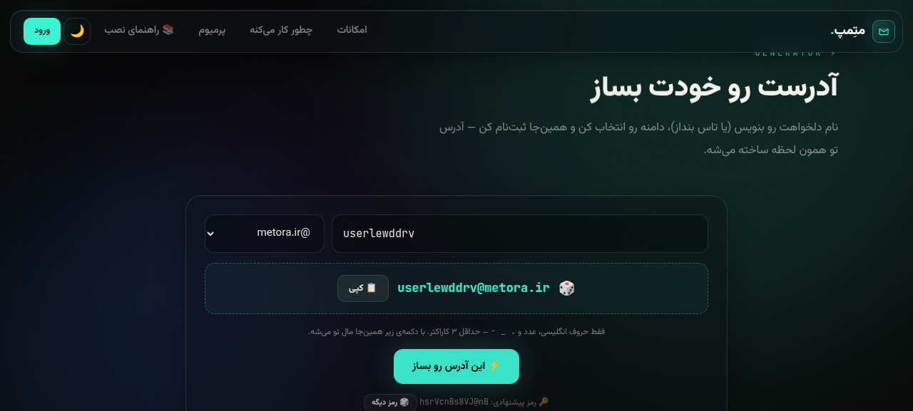
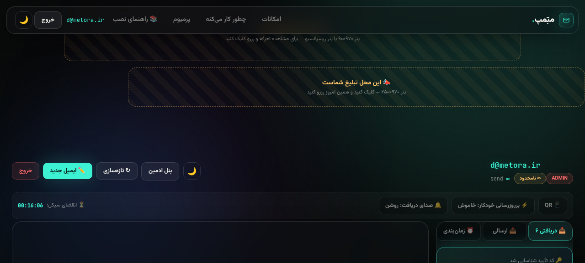
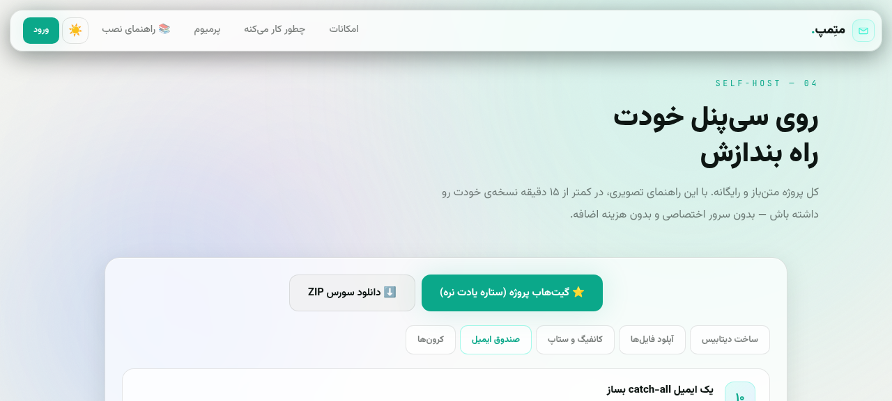
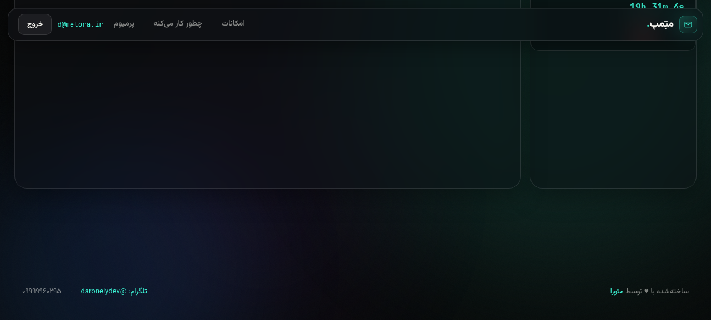
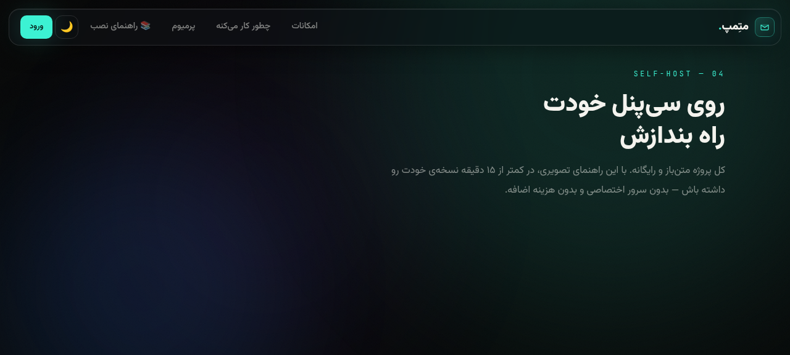
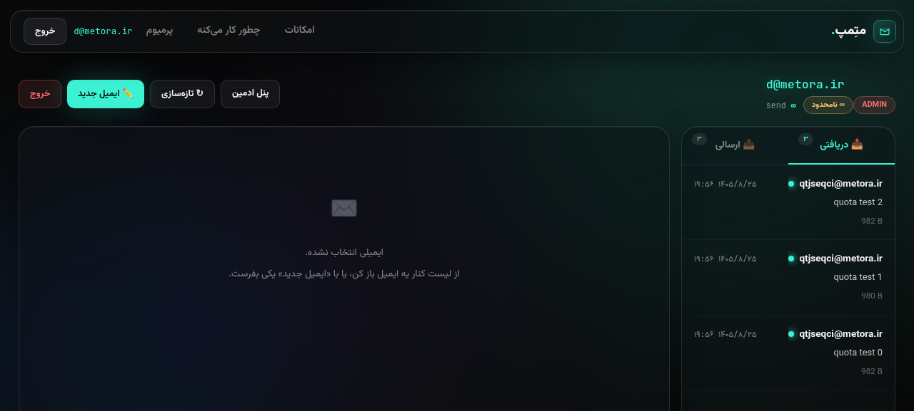
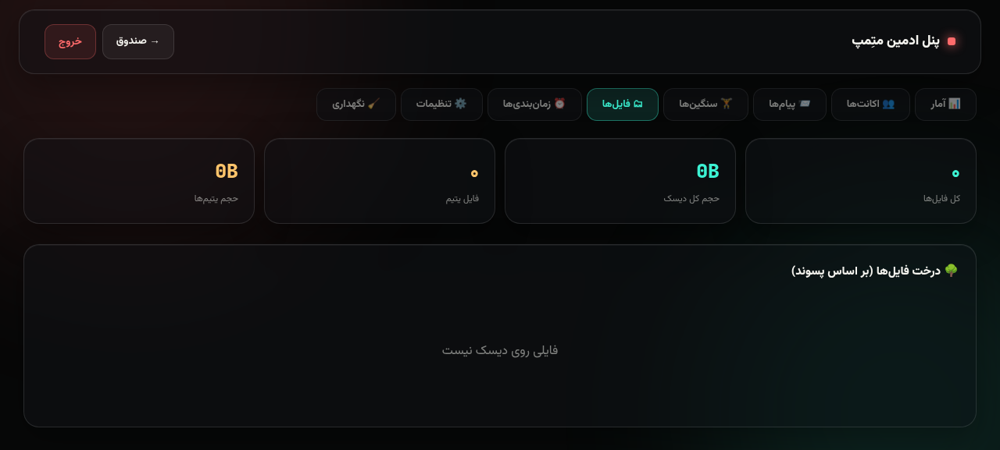

<div align="center">


# ⚡ متِمپ — Metora TempMail

**ایمیل موقتی که واقعاً کار می‌کنه** — بفرست، بگیر، پیوست کن، زمان‌بندی کن. بدون اسپم، بدون دردسر.

[](https://temp.metora.ir)


🌐 **[English](README.md)** · **[Русский](README.ru.md)** · **فارسی**

*سرویس کامل ایمیل موقت روی هاست اشتراکی cPanel معمولی — بدون سرور اختصاصی، بدون سرویس ابری، بدون فریم‌ورک.*

**[🚀 دمو زنده](https://temp.metora.ir)** · **[✨ امکانات](#-امکانات)** · **[🎨 افکت‌های-UI](#️-تجربه-و-رابط-کاربری)** · **[📦 نصب](#️-نصب-روی-cpanel-۵-دقیقه)**

</div>

---

## 🎯 چرا متِمپ؟

| قابلیت | متِمپ | سرویس‌های معمول |
|:---|:---:|:---:|
| آدرس اختصاصی `@metora.ir` | ✅ | ✅ |
| **ارسال** ایمیل واقعی | ✅ | ❌ |
| دریافت ایمیل واقعی (MIME کامل) | ✅ | ✅ |
| پیوست تا ۲ مگابایت | ✅ | بعضی‌ها |
| **⏰ ارسال زمان‌بندی‌شده** | ✅ | ❌ |
| **🔑 استخراج خودکار کد تأیید (OTP)** | ✅ | ❌ |
| **🎨 سازنده ایمیل دلخواه + دامنه** | ✅ | ❌ |
| **📱 QR برای انتقال به موبایل** | ✅ | ❌ |
| **🌗 تم تاریک / روشن** | ✅ | ❌ |
| **⭐ ایمیل‌های مهم + فیلترها** | ✅ | ❌ |
| **📤 خروجی EML استاندارد** | ✅ | ❌ |
| **🎭 هویت ساختگی برای تست** | ✅ | ❌ |
| **🔊 صدای دریافت ایمیل** | ✅ | ❌ |
| پاسخ‌دادن با نقل قول | ✅ | ❌ |
| ریست خودکار هر ۶ ساعت | ✅ | ❌ |
| **پنل ادمین ۸ تب + سهمیه داینامیک** | ✅ | ❌ |
| UI فارسی RTL با Particle Typography | ✅ | ❌ |

> 🧹 **فلسفه متِمپ:** هیچ‌چیز نمی‌ماند. هر ۶ ساعت کل صندوق‌ها پاک می‌شوند؛ فقط آدرس و رمز تو می‌ماند. اگر ۱۰ روز سراغش نروی، کل اکانت هم پاک می‌شود.

---

## ✨ امکانات

### 👤 برای کاربر
- **ثبت‌نام ۱۰ ثانیه‌ای** — نه شماره، نه کپچا، نه وریفای
- **کلاینت کامل** — دریافتی/ارسالی با شمارنده، پاسخ با نقل قول، دانلود پیوست، درگ‌اند‌دراپ
- **⏰ ارسال زمان‌بندی‌شده** — بنویس، تاریخ بگذار، خودکار ارسال می‌شود؛ با شمارش معکوس زنده و دکمه لغو
  - هر روز یک ایمیل زمان‌بندی‌شده · حداکثر ۵ در انتظار · پیوست ≤ ۱MB · زمان به وقت تهران
- **شمارنده سهمیه زنده** — همیشه می‌دانی چند ارسال مانده
- **🎨 سازنده ایمیل دلخواه** — نام دلخواه یا تصادفی (🎲)، انتخاب دامنه از دامنه‌های موجود، رمز پیشنهادی امن و ساخت آنی آدرس
- **🔑 استخراج خودکار OTP** — کدهای تأیید ۴ تا ۸ رقمی داخل ایمیل‌های ناخوانده خودکار شناسایی و در یک **کارت بزرگ درخشان** با دکمه کپی نمایش داده می‌شوند (بدون علامت‌خوردن ایمیل)
- **📱 QR Code** — آدرس ایمیلت را با یک QR به موبایل منتقل کن
- **⚡ برروزرسانی خودکار** — دکمه‌ی قابل‌مشاهده برای چک‌کردن صندوق هر ۱۰ ثانیه
- **🔔 صدای دریافت** — زنگ نرم WebAudio هنگام رسیدن ایمیل جدید (قابل خاموش‌کردن)
- **🌗 تم تاریک/روشن** — با یک کلیک و ذخیره در مرورگر
- **⏳ تایمر انقضای سیکل** — شمارش معکوس زنده تا ریست بعدی ۶ ساعته
- **⭐ ایمیل‌های مهم** — ستاره‌گذاری (ذخیره در مرورگر) + فیلترهای همه/مهم‌ها/ناخوانده/دارای پیوست
- **📤 خروجی EML** — هر ایمیل را با فرمت استاندارد `.eml` دانلود کن (باز می‌شود در Outlook/Thunderbird)
- **🎭 هویت تصادفی** — نام، موبایل، آدرس، کدپستی و... برای تست فرم‌ها، با یک کلیک در کلیپ‌بورد
- **📚 راهنمای تصویری نصب** — ۱۵ مرحله با اسکرین‌شات، داخل خود سایت (بخش «راهنمای نصب»)
- **📣 جای تبلیغ** — ۴ جایگاه تبلیغاتی رزروشدنی از طریق تلگرام

### 👑 برای ادمین (پنل ۸ تب)
| تب | امکانات |
|:---|:---|
| 📊 آمار | اکانت‌ها، پیام‌ها، فایل‌های یتیم، حجم دیتابیس |
| 👥 اکانت‌ها | پرمیوم‌کردن، حذف |
| 📨 پیام‌ها | مشاهده و حذف هر پیام |
| 🏋️ **سنگین‌ها** | فیلتر حجمی پیام‌های بزرگ بر اساس نوع پیوست (عکس/ویدیو/صدا/PDF/ZIP) |
| 🗂 **فایل‌ها** | درخت فایل‌ها بر اساس پسوند با نوار درصد، بج یتیم، حذف گروهی هر پسوند |
| ⏰ **زمان‌بندی‌ها** | دیدن و حذف زمان‌بندی‌های همه کاربران |
| ⚙️ تنظیمات | **همه سهمیه‌ها قابل ویرایش زنده** + افزودن/سلب ادمینی + تغییر رمز |
| 🧹 نگهداری | ۴ ریست + **پاکسازی هوشمند نوعی** (همه عکس‌ها/ویدیوها/صداها/اسناد/آرشیوها/فقط متن‌ها) |

---

## 🎨 تجربه و رابط کاربری

| افکت | توضیح |
|:---|:---|
| **🪐 Particle Typography v2** | تیتر اصلی از **هزاران پارتیکل نئونی تیز** ساخته می‌شود — در حالت سکون حروف کاملاً خوانا و براق‌اند و فقط وقتی موس رویشان می‌رود منفجر می‌شوند و به‌آرامی به جای خودشان برمی‌گردند |
| **✨ Particle Typing** | موقع تایپ، جرقه‌های پارتیکلی دور کرسر می‌ترکند |
| **🧲 Magnetic Buttons** | دکمه‌ها مثل آهن‌ربا به موس کشیده می‌شوند |
| **📝 Word Reveal** | تیترها موقع اسکرول کلمه‌کلمه با بلر ظاهر می‌شوند |
| **🌊 Liquid Glass** | کل رابط شیشه‌ای با backdrop-blur و حاشیه نورانی |
| **☄️ Aurora + Grain** | پس‌زمینه سه‌لکه‌نوری متحرک + بافت گرین سینمایی |
| **⌨️ Live Typer + Countdown** | تایپ زنده ایمیل نمونه + شمارش معکوس ثانیه‌ای زمان‌بندی‌ها و انقضای سیکل |
| **🌗 تم دوگانه** | کل رابط در دو حالت تاریک نئونی و روشن مینیمال، با ذخیره‌سازی انتخاب |

همه افکت‌ها `prefers-reduced-motion` را رعایت می‌کنند و روی **390 / 768 / 1440px** تست‌شده‌اند — بدون هیچ سرریز افقی.

<div align="center">
<table><tr>
<td></td>
<td></td>
</tr><tr>
<td align="center"><sub>🎨 سازنده ایمیل دلخواه</sub></td>
<td align="center"><sub>🔑 کارت بزرگ کد تأیید خودکار</sub></td>
</tr><tr>
<td></td>
<td></td>
</tr><tr>
<td align="center"><sub>🌗 حالت روشن</sub></td>
<td align="center"><sub>📱 انتقال آدرس با QR</sub></td>
</tr><tr>
<td></td>
<td></td>
</tr><tr>
<td align="center"><sub>⏰ زمان‌بندی با شمارش معکوس</sub></td>
<td align="center"><sub>📚 راهنمای تصویری نصب (۱۵ مرحله)</sub></td>
</tr><tr>
<td></td>
<td></td>
</tr><tr>
<td align="center"><sub>کلاینت کامل با نوار ابزار v4</sub></td>
<td align="center"><sub>🗂 درخت فایل‌های ادمین</sub></td>
</tr></table>
</div>

---

## 🏗️ معماری

```
External mail ──▶ MX (Exim) ──catch-all──▶ IMAP poll (هر دقیقه) ──▶ MySQL
                                                                        ▲
Browser SPA ◀──── REST API (PHP) ◀──────────────────────────────────────┘
                     │
                     ├── send.php (ارسال فوری + سهمیه)
                     ├── schedule.php (زمان‌بندی + قوانین)
                     └── admin.php (۸ بخش مدیریتی)

Cron:  * * * * *  imap_poll + process_scheduled (زمان‌بندی‌ها)
       0 */6 * * *  reset_cycle (ریست ۶ ساعته)
       30 3 * * *  purge_inactive (اکانت‌های ۱۰ روزه)
```

| مسیر | توضیح |
|:---|:---|
| `/` | اپ تک‌صفحه‌ای (Landing + کلاینت + زمان‌بندی) |
| `/api/schedule.php` | ساخت/لیست/لغو زمان‌بندی با همه قوانین |
| `/cron/process_scheduled.php` | هر دقیقه: ارسال زمان‌بندی‌های سررسیده (قفل GET_LOCK) |
| `/api/admin.php` | ۲۰+ اکشن مدیریتی |

---

## 🔧 نصب روی cPanel (۱۵ دقیقه — با تصویر)

> 💡 **راهنمای تصویری کامل ۱۵ مرحله‌ای داخل خود سایت هست:** [temp.metora.ir/#guide](https://temp.metora.ir/#guide)

1. **آپلود** محتوا در docroot ساب‌دامین
2. **دیتابیس** بسازید (MySQL Databases) و دسترسی کامل بدهید
3. **کانفیگ**: `includes/config.sample.php` → `config.php` را پر کنید
4. **صندوق catch-all** بسازید و Default Address را رویش بگذارید
5. **setup.php** را یک‌بار باز کنید و **بعد حذفش کنید**
6. **Cron Jobs**:
   ```
   * * * * *           php -q .../cron/imap_poll.php
   * * * * *           php -q .../cron/process_scheduled.php
   0 0,6,12,18 * * *   php -q .../cron/reset_cycle.php
   30 3 * * *          php -q .../cron/purge_inactive.php
   ```
7. با ادمین seed لاگین کنید و از ⚙️ تنظیمات رمز و سهمیه‌ها را بگذارید

> 🔐 `config.php` در `.gitignore` است؛ `.htaccess` دسترسی مستقیم به `includes/`, `storage/`, `cron/` را می‌بندد.

---

## 📊 سهمیه‌ها (پیش‌فرض — همه از پنل قابل تغییر)

| | رایگان | پرمیوم | ادمین |
|:---|:---:|:---:|:---:|
| ارسال / سیکل ۶ ساعته | ۱۰ | ۱۰۰ | **∞** |
| صندوق دریافتی | ۵۰ | ۵۰۰ | **∞** |
| پیوست / ایمیل | ۱ | ۵ | ۱۰ |
| حجم هر پیوست | ۲MB | ۲MB | ۲MB |

---

## 🗂️ دیتابیس

```
accounts · messages · attachments · send_log · cycles · settings
scheduled_messages (to_addr, send_at, status[pending|sent|failed|canceled], att_json, …)
```

---

## 🛡️ امنیت

bcrypt+pepper · prepared statements همه‌جا · سشن HttpOnly/SameSite · پیوست خارج از docroot با نام تصادفی · دانلود فقط برای مالک · اعتبارسنجی کامل ورودی‌ها · قفل GET_LOCK روی کرون‌ها

---

## 🤝 پشتیبانی

**تلگرام:** [@daronelydev](https://t.me/daronelydev) · **تلفن:** ۰۹۹۹۹۹۶۰۲۹۵

## 📄 لایسنس

MIT — آزادانه fork کنید، ولی اسپم نسازید 🙂

<div align="center">
<sub>ساخته‌شده با ♥ توسط <a href="https://github.com/Daronely">Daronely</a> زیر چتر <a href="https://metora.ir">Metora</a></sub>
</div>


---

## 🆕 نسخه ۶.۲

- **موتور ارسال Direct-SMTP**: پیام‌ها مستقیم به MX گیرنده تحویل داده می‌شوند (با STARTTLS و fallback خودکار) — ارسال روی هاست‌های اشتراکی که صف exim‌شان گیر می‌کند هم کار می‌کند.
- **پنل ادمین سه‌زبانه** شد (EN / فارسی / RU) با ۱۸۳ رشته ترجمه‌شده و RTL کامل.
- **بخش تعرفه‌ها** حالا در هر سه زبان کاملاً همگام است (کارت‌های Free/Premium، خطوط سهمیه، قیمت ماهانه).
- متن‌های صفحه اصلی بازنویسی و حرفه‌ای‌تر شدند.
- README اصلی ریپو انگلیسی است؛ این فایل نسخه فارسی آن است.
