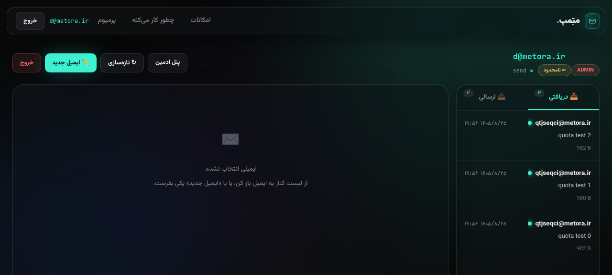
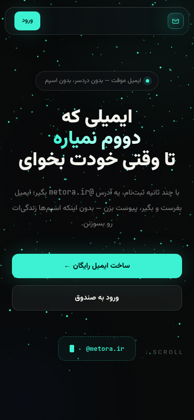

<div align="center">


# ⚡ متِمپ — Metora TempMail

**ایمیل موقتی که واقعاً کار می‌کنه** — بفرست، بگیر، پیوست کن. بدون اسپم، بدون دردسر.

[](https://temp.metora.ir)


*یک سرویس ایمیل موقت کامل روی هاست اشتراکی cPanel معمولی — بدون سرور اختصاصی، بدون سرویس ابری، بدون فریم‌ورک.*

**[🚀 دمو زنده](https://temp.metora.ir)** · **[✨ امکانات](#-امکانات)** · **[📦 نصب ۵ دقیقه‌ای](#️-نصب-روی-cpanel-۵-دقیقه)** · **[🎨 افکت‌های UI](#️-تجربه-و-رابط-کاربری)**

</div>

---

## 🎯 چرا متِمپ؟

بیشتر سرویس‌های ایمیل موقت فقط **دریافت** دارند و ظاهری از دهه‌ی قبل. متِمپ فرق دارد:

| قابلیت | متِمپ | سرویس‌های معمول |
|:---|:---:|:---:|
| آدرس اختصاصی `@metora.ir` | ✅ | ✅ |
| **ارسال** ایمیل واقعی | ✅ | ❌ |
| دریافت ایمیل واقعی (MIME کامل) | ✅ | ✅ |
| پیوست تا ۲ مگابایت (بفرست و بگیر) | ✅ | بعضی‌ها |
| پاسخ‌دادن (Reply) با نقل قول | ✅ | ❌ |
| ریست خودکار هر ۶ ساعت | ✅ | ❌ |
| **پنل ادمین کامل + سهمیه‌های داینامیک** | ✅ | ❌ |
| UI فارسی RTL با Particle Typography | ✅ | ❌ |

> 🧹 **فلسفه متِمپ:** هیچ‌چیز نمی‌ماند. هر ۶ ساعت کل صندوق‌ها پاک می‌شوند؛ فقط آدرس و رمز تو می‌ماند. اگر ۱۰ روز سراغش نروی، کل اکانت هم پاک می‌شود — مثل اینکه هرگز وجود نداشته.

---

## ✨ امکانات

### برای کاربر
- **ثبت‌نام ۱۰ ثانیه‌ای** — فقط نام کاربری و رمز؛ نه شماره‌ی تلفن، نه کپچا، نه وریفای
- **کلاینت ایمیل کامل** — Inbox و Sent با شمارنده، خواندن، حذف، پاسخ با نقل قول، دانلود پیوست
- **درگ‌اند‌دراپ پیوست** — با اعتبارسنجی حجم و تعداد، به‌صورت زنده
- **شمارنده سهمیه زنده** — همیشه می‌دانی چند ارسال باقی مانده
- **پلن پرمیوم** — صندوق بزرگ‌تر، ارسال بیشتر، ۵ پیوست در هر ایمیل

### برای ادمین
- **سهمیه‌های داینامیک** — همه‌ی عددها (ارسال/دریافت/پیوست برای رایگان، پرمیوم و ادمین + قیمت پلن) از پنل قابل ویرایش‌اند و **بدون دست‌زدن به کد** بلافاصله اعمال می‌شوند
- **حالت «ادمین نامحدود»** — یک toggle: سهمیه‌ها هرگز برای شما اعمال نمی‌شوند (∞)
- **۴ ابزار نگهداری**:
  - 🔄 ریست کامل (مثل کرون ۶ ساعته)
  - 📭 پاک‌کردن فقط صندوق خودت (که هاست پر نشود)
  - 🧹 حذف فایل‌های یتیم از دیسک
  - 👻 حذف اکانت‌های ۱۰ روزه بی‌استفاده
- **آمار زنده** — اکانت‌ها، پیام‌ها، پیوست‌ها، **تعداد فایل‌های یتیم** و **حجم دیتابیس**
- **مدیریت اکانت‌ها** — پرمیوم‌کردن/لغو با یک کلیک، حذف کامل

---

## 🎨 تجربه و رابط کاربری

UI متِمپ با وسواس طراحی شده — نه یک قالب، بلکه یک تجربه:

| افکت | توضیح |
|:---|:---|
| **🪐 Particle Typography** | تیتر اصلی صفحه با **هزاران پارتیکل نئونی** ساخته می‌شود که از فضا به هم می‌چسبند و کلمات را می‌سازند — و با موس فرار می‌کنند! |
| **✨ Particle Typing** | موقع تایپ در فرم ارسال، جرقه‌های پارتیکلی دور محل تایپ می‌ترکند |
| **🧲 Magnetic Buttons** | دکمه‌ها به سمت موس شما کشیده می‌شوند، مثل آهن‌ربا |
| **📝 Word Reveal** | تیترها موقع اسکرول، کلمه‌به‌کلمه با بلر و چرخش ظاهر می‌شوند |
| **🌊 Liquid Glass** | کل رابط با backdrop-blur و حاشیه‌های نورانی، شیشه‌ای و شناور |
| **☄️ Aurora Background** | سه لکه‌ی نور رنگی که آرام در پس‌زمینه حرکت می‌کنند + بافت گرین سینمایی |
| **⌨️ Live Typer** | چیپ ایمیل هرو، اسم‌های نمونه را تایپ و پاک می‌کند |
| **🔁 Ripple + Shine** | موج روی کلیک و برق گذرنده روی دکمه‌ی اصلی |

و همه‌ی این‌ها **رعایت `prefers-reduced-motion`** را می‌کنند و روی موبایل هم روان‌اند (تست‌شده روی 390px، 768px و 1440px).

<div align="center">
 
<br/><sub>کلاینت ایمیل روی دسکتاپ و موبایل</sub>
</div>

---

## 🏗️ معماری

```
                       ┌──────────────────────────────────┐
   External mail ─────▶│  MX (mail.metora.ir, Exim)       │
                       │  catch-all → tempmail@metora.ir  │
                       └──────────────┬───────────────────┘
                                      │ IMAP (هر ۱ دقیقه)
                                      ▼
   ┌────────────┐   REST    ┌─────────────────────┐
   │ Browser UI │◀─────────▶│  PHP 8.1 (LiteSpeed)│◀── MySQL
   │ (SPA, RTL) │           │  temp.metora.ir     │     + جدول settings
   └────────────┘           └──────────┬──────────┘      (سهمیه‌های داینامیک)
                                       │ mail() → sendmail
                                       ▼
                                 Outgoing email
```

| مسیر | توضیح |
|:---|:---|
| `/` | اپ تک‌صفحه‌ای (Landing + Mail client + همه‌ی افکت‌ها) |
| `/api/auth.php` | ثبت‌نام / ورود (bcrypt + pepper, session hardening) |
| `/api/send.php` | ارسال با MIME multipart + پیوست + سهمیه |
| `/api/messages.php` `message.php` `delete.php` | CRUD صندوق |
| `/api/download.php` | دانلود امن پیوست (فقط مال خودت) |
| `/api/quotas.php` | سهمیه‌های عمومی برای صفحه‌ی اصلی (بدون لاگین) |
| `/api/admin.php` | همه‌ی عملیات ادمین: آمار، اکانت‌ها، پیام‌ها، **تنظیمات**، **ریست‌ها** |
| `/cron/imap_poll.php` | هر دقیقه: ایمیل‌های catch-all را با پارس کامل MIME به inbox کاربران منتقل می‌کند |
| `/cron/reset_cycle.php` | هر ۶ ساعت: پاک‌سازی کامل پیام‌ها + شروع سیکل جدید |
| `/cron/purge_inactive.php` | روزانه: حذف اکانت‌های ۱۰ روزه بی‌فعالیت |
| `/admin/` | پنل ادمین (۵ تب) |
| `pipe/pipe.php` | جایگزین pipe-to-program برای هاست‌هایی که pipe دارند |

---

## 🔧 نصب روی cPanel (۵ دقیقه)

### پیش‌نیازها
- هاست cPanel با PHP 8.1+ (افزونه‌های `imap`, `mysqli`, `mbstring`, `fileinfo`) — روی اکثر هاست‌ها فعاله
- یک دامنه که MX آن به هاست اشاره کند

### مراحل

1. **آپلود** — محتوای ریپو را در docroot ساب‌دامین بگذارید (مثلاً `~/temp.example.com`)

2. **دیتابیس** — از cPanel → MySQL® Databases یک دیتابیس و یوزر بسازید و ALL PRIVILEGES بدهید

3. **کانفیگ** — `includes/config.sample.php` را به `config.php` کپی و پر کنید:
   ```php
   define('DB_NAME', 'cpuser_tempmail');
   define('DB_USER', 'cpuser_tempmail');
   define('DB_PASS', '••••');
   define('MAIL_DOMAIN', 'example.com');      // دامنه‌ی آدرس‌های ایمیل
   define('CATCHALL_USER', 'catchall@example.com');
   define('CATCHALL_PASS', '••••');
   define('PEPPER', 'یک-رشته‌ی-تصادفی-طولانی');
   ```

4. **صندوق catch-all** — از cPanel → Email Accounts یک ایمیل بسازید و رمزش را در `CATCHALL_PASS` بگذارید

5. **Default Address** — از cPanel → Email → Default Address گزینه‌ی *Forward to Email Address* را روی همان صندوق بگذارید (یا با API: `Email::setdefaultaddress` با `fwdopt=fwd`)

6. **نصب** — یک‌بار `https://temp.example.com/setup.php` را باز کنید تا جدول‌ها ساخته و seed شوند، **بعد فایل را حذف کنید!**

7. **Cron Jobs** — از cPanel → Cron Jobs:
   ```
   * * * * *           /usr/local/bin/php -q ~/temp.example.com/cron/imap_poll.php
   0 0,6,12,18 * * *   /usr/local/bin/php -q ~/temp.example.com/cron/reset_cycle.php
   30 3 * * *          /usr/local/bin/php -q ~/temp.example.com/cron/purge_inactive.php
   ```

8. **اولین ورود** — با ادمین seed شده لاگین کنید و از پنل → تنظیمات، رمز و سهمیه‌ها را تنظیم کنید

> 🔐 **نکته‌ی امنیتی:** `includes/config.php` در `.gitignore` است و `.htaccess` هم دسترسی مستقیم به `includes/`, `storage/`, `state/`, `cron/`, `pipe/` را می‌بندد.

---

## 📊 سهمیه‌ها (پیش‌فرض — همه از پنل قابل تغییر)

| | رایگان | پرمیوم | ادمین |
|:---|:---:|:---:|:---:|
| ارسال در هر سیکل ۶ ساعته | ۱۰ | ۱۰۰ | **∞ نامحدود*** |
| نگهداری ایمیل دریافتی | ۵۰ | ۵۰۰ | **∞ نامحدود*** |
| پیوست در هر ایمیل | ۱ | ۵ | ۱۰ |
| حجم هر پیوست | ۲MB | ۲MB | ۲MB |

\* با toggle «ادمین نامحدود»؛ اگر خاموشش کنید سهمیه‌ی عددی ادمین اعمال می‌شود.

---

## 🗂️ دیتابیس

```
accounts   (id, username, email, password_hash, role, is_premium, premium_until, last_active_at)
messages   (id, account_id, folder[inbox|sent], from_addr, to_addr, subject, body_text, body_html, …)
attachments(id, message_id, filename, mime, size_bytes, file_path)
send_log   (id, account_id, cycle_id, created_at)     ← شمارنده‌ی سهمیه
cycles     (id, started_at)                            ← هر ریست ۶ ساعته یک ردیف
settings   (k, v)                                      ← سهمیه‌ها و قیمت، قابل ویرایش از پنل
```

---

## 🛡️ امنیت

- رمزها: `bcrypt(cost 11)` + static pepper
- کوکی سشن: `HttpOnly`, `SameSite=Lax`, `Secure` (وقتی HTTPS)
- همه‌ی کوئری‌ها prepared statement
- پیوست‌ها با نام hex تصادفی خارج از docroot ذخیره می‌شوند و MIME با `finfo` تشخیص داده می‌شود
- دانلود پیوست فقط برای مالک پیام
- `includes/` با `.htaccess` از دسترسی مستقیم بسته شده
- اعتبارسنجی سمت سرور برای همه‌ی ورودی‌ها (ایمیل، حجم، تعداد پیوست، طول متن)

---

## 📱 ریسپانسیو

تست‌شده روی **390px (موبایل)، 768px (تبلت) و 1440px (دسکتاپ)** — هر دو صفحه‌ی اصلی و پنل ادمین: ناوبری جمع‌وجور، دکمه‌های CTA تمام‌عرض، جدول‌ها با اسکرول داخلی، و **هیچ سرریز افقی در هیچ viewport**.

---

## 🤝 پشتیبانی

- **تلگرام:** [@daronelydev](https://t.me/daronelydev)
- **تلفن:** ۰۹۹۹۹۹۶۰۲۹۵

## 📄 لایسنس

MIT — آزادانه fork کنید، ولی اسپم نسازید 🙂

<div align="center">
<sub>ساخته‌شده با ♥ توسط <a href="https://github.com/Daronely">Daronely</a> زیر چتر <a href="https://metora.ir">Metora</a></sub>
</div>
