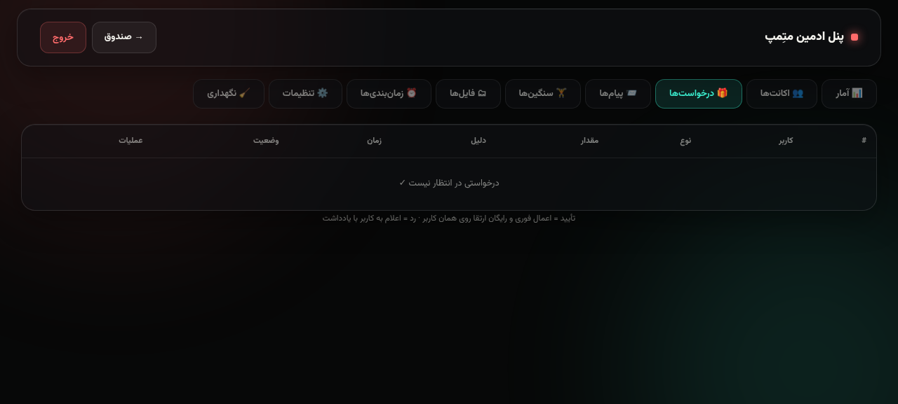

<div align="center">


# ⚡ Metora TempMail

**A disposable email service that actually works — real sending, real receiving, real attachments.**

Self-hosted on any cPanel shared host in ~20 minutes. No Node.js, no Docker, no database server to babysit — just PHP + MySQL + a catch-all mailbox.

[](https://temp.metora.ir/)
[](LICENSE)
[]()
[]()

**[English](README.md)** · **[فارسی](README.fa.md)** · **[Русский](README.ru.md)**

</div>

---

## 🤔 Why Metora?

Most temp-mail services are **read-only toys**: you can receive mail, but try *replying* to a verification email or *sending* an attachment and you hit a wall. Metora is a full mail client wrapped around a disposable identity:

| Capability | Typical temp-mail | Metora |
|---|:-:|:-:|
| Receive email (incl. from Gmail, Outlook…) | ✅ | ✅ |
| **Send** email to any address | ❌ | ✅ |
| Attachments (send **and** receive, up to 2 MB) | ❌ | ✅ |
| **Automatic OTP / verification-code extraction** | ❌ | ✅ |
| Scheduled sending (“send this in 2 hours”) | ❌ | ✅ |
| QR hand-off — beam your inbox to your phone & **log in by scanning** | ❌ | ✅ |
| Trilingual UI with full RTL | ❌ | ✅ |
| Self-host on cheap shared hosting | ❌ | ✅ |

Everything is wiped automatically every 6 hours — the whole inbox, attachments and all — so the service stays clean and your users stay anonymous.

---

## 📸 What it looks like

| Landing (dark neon) | Inbox & OTP extraction |
|---|---|
|  |  |

| Scheduled send | QR login (scan → you're in) |
|---|---|
|  |  |

<details>
<summary><b>More screenshots</b></summary>

| Persian UI (RTL) | Admin panel (trilingual) |
|---|---|
|  |  |


</details>

---

## 🚀 Features

- **⚡ 10-second signup** — just a username and a password. No phone, no captcha, no personal data.
- **📥 Real receiving** — a catch-all mailbox + IMAP poller (runs every minute) delivers mail from *any* external sender (Gmail, Outlook, …) into the right inbox, with **SHA-256 de-duplication** and a 5-minute fuzzy-dedup fallback.
- **📤 Real sending** — outbound mail goes through a **direct-SMTP engine** (socket to the recipient's MX, STARTTLS when offered, automatic plaintext fallback) with the local MTA as a reserve route. Verified working against Gmail.
- **🔑 Automatic OTP extraction** — verification codes inside unread mail are detected and shown in a big glowing card with a one-click copy button.
- **📎 Attachments both ways** — up to 2 MB per file (10 files / 2× max aggregate on receive), MIME type preserved from the sender.
- **⏰ Scheduled sending** — write now, pick a time, watch the live countdown; the cron fires it exactly on schedule.
- **📱 QR hand-off & scan-to-login** — beam your address to your phone, or mint a **single-use 10-minute login QR**: scan it with any device and you land inside the account. Replay-proof by design.
- **🌍 Trilingual UI** — English, فارسی (full RTL) and Русский, switchable from the navbar, persisted to both the session and the account.
- **🌗 Dark / light theme** with the whole neon-glass design system.
- **🛡 Hardened by default** — CSRF double-submit tokens, login rate-limiting (10 fails / 15 min lockout), registration throttling, password policy, per-account `GET_LOCK` serialization for quota races, `Content-Security-Policy`, security headers via `.htaccess`.

### Admin panel (trilingual since v6.2)
- 📊 Live stats (accounts, messages, cycle load, DB size, orphan files)
- 👥 Account management — promote/demote premium, per-user quota **overrides**, delete
- 🎁 Resource **requests queue** — users ask for more quota with a reason; admins approve/reject in one click, the override applies instantly
- 📨 Message viewer & moderation across all accounts
- 🏋️ Heavy-message explorer — filter by attachment type / size
- 🗂 File tree by extension with per-extension purge
- ⚙️ Quota settings (free / premium / admin tiers), premium price, unlimited-admin toggle
- 👑 Add/revoke admins, change password
- 🧹 Maintenance — full reset, self-inbox reset, orphan cleanup, inactive purge, smart purge by content type (images / videos / audio / PDF / archives / plain-text)

---

## 🧱 Architecture

```
                 ┌────────────────────────────────────────────────┐
                 │                     cPanel                     │
                 │                                                │
  Incoming SMTP  │  catch-all mailbox ──► cron/imap_poll.php      │
 ─────────────►  │                          │  (IMAP, every min)  │
  (any sender)   │                          ▼                     │
                 │                     mail_parser.php ──► MySQL  │
                 │                          │                     │
                 │  index.html ◄── api/*.php (JSON + CSRF)        │
                 │     ▲            │                             │
                 │     │            ▼                             │
                 │  you ──► send.php ──► includes/mailer.php      │
                 │                        │                       │
                 │                        ├─► Direct SMTP ──► recipient MX
                 │                        └─► mail() (local exim, fallback)
                 │                                                │
                 │  cron: imap_poll · process_scheduled ·         │
                 │        reset_cycle (6h) · purge_inactive (d)   │
                 └────────────────────────────────────────────────┘
```

**Why direct SMTP?** On many shared hosts the local exim queue stalls silently for app-generated mail (PHP `mail()` returns true, the message never leaves). Metora therefore talks **directly to the recipient's MX** — the same hop Gmail itself answered `250 2.0.0 OK` to in testing — and only falls back to the local MTA. Same-domain mail is routed through the catch-all pipeline as before.

<details>
<summary><b>📁 File map</b></summary>

| Path | Purpose |
|---|---|
| `index.html` | Landing + full mail client (single file, no build step) |
| `admin/index.html` | Trilingual admin panel |
| `assets/js/i18n.js` | EN/FA/RU dictionaries + language engine |
| `api/auth.php` | Login / register / QR-login / rate limiting |
| `api/send.php` | Atomic send (quota lock → direct SMTP → sent copy) |
| `api/schedule.php` | Scheduled sends |
| `api/messages.php`, `message.php` | Inbox / message fetch |
| `api/download.php`, `delete.php`, `export.php` | Attachments & cleanup |
| `api/me.php`, `quotas.php`, `lang.php`, `logout.php` | Session / public quotas / language |
| `api/qr.php` | Mint single-use QR login tokens |
| `api/requests.php` | Resource requests (user side) |
| `api/admin.php` | All admin actions (CSRF-protected) |
| `includes/mailer.php` | MIME builder + direct-SMTP engine |
| `includes/mail_parser.php` | RFC-2822 parser (multipart, attachments, OTP sniffing) |
| `includes/db.php`, `helpers.php` | PDO + helpers (cycles, quotas, locks) |
| `includes/config.sample.php` | Copy to `config.php` and fill in |
| `cron/imap_poll.php` | Pull catch-all over IMAP (socket fallback included) |
| `cron/process_scheduled.php` | Fire scheduled sends |
| `cron/reset_cycle.php` | 6-hour wipe |
| `cron/purge_inactive.php` | Daily inactive-account purge |
| `setup.php` | One-shot schema + seed admin (delete after use!) |

</details>

---

## 🛠 Installation (cPanel, ~20 minutes)

> Full visual walkthrough with 15 screenshots lives on the [live site → “Self-host” section](https://temp.metora.ir/#guide).

1. **Database** — cPanel → *MySQL® Databases*: create a DB, a user, grant **ALL PRIVILEGES**. Note the full prefixed names (e.g. `user_tempmail`).
2. **Upload** — clone/download this repo, upload the contents into your subdomain folder (e.g. `public_html/temp`), extract.
3. **Config** — copy `includes/config.sample.php` → `includes/config.php`, fill in DB credentials, your mail domain, and the seed admin. Every constant is commented.
4. **Setup** — open `https://temp.yoursite.com/setup.php` once, then **delete it** from File Manager.
5. **Catch-all mailbox** — create a mailbox on your mail domain (e.g. `tempmail@yoursite.com`), note its password for the config.
6. **Default Address** — set the domain's *Default Address* to **Forward to** that mailbox, so every `anything@yoursite.com` flows in.
7. **MX** — if the domain's email lives elsewhere, point its MX to this host in *Zone Editor*.
8. **Cron jobs** — add these four (replace paths with yours):

```
* * * * *      php -q /home/USER/temp/cron/imap_poll.php
* * * * *      php -q /home/USER/temp/cron/process_scheduled.php
0 0,6,12,18 * * *  php -q /home/USER/temp/cron/reset_cycle.php
30 3 * * *     php -q /home/USER/temp/cron/purge_inactive.php
```

Done 🎉 — log in with the seed admin, change the password, tune quotas from the admin panel.

### Upgrading from an earlier version
Replace `index.html`, `admin/index.html`, `assets/js/i18n.js`, everything under `api/`, `includes/` and `cron/`. Your `config.php` and database are untouched. New columns (dedupe, overrides, qr_tokens, resource_requests) are added automatically by `setup.php` — re-run it once (it is idempotent) and delete it again.

---

## ⚙️ Configuration reference

All settings live in `includes/config.php`. The important ones:

| Constant | Meaning |
|---|---|
| `MAIL_DOMAIN` | The domain addresses live on (`metora.ir` in production) |
| `IMAP_HOST` / `IMAP_USER` / `IMAP_PASS` | The catch-all mailbox credentials |
| `RESET_HOURS` | Inbox wipe interval (default 6) |
| `MAX_UPLOAD_MB` | Per-attachment cap (default 2) |
| Seed admin | Created by `setup.php`; change its password immediately |

Quota *values* (free/premium sends, inbox retention, attachment counts, premium price) are editable at runtime from **Admin → Settings** — no code edits needed. Per-user overrides take precedence over plan values.

---

## 🔒 Security notes

- **CSRF**: every mutating API call requires the double-submit token (`X-CSRF` header).
- **Rate limiting**: 10 failed logins per email+IP → 15-minute lockout; 20 registrations/hour/IP; minimum 8-char alphanumeric passwords.
- **Quota races**: sends and scheduling run inside per-account MySQL `GET_LOCK`, so concurrent requests can't double-spend quota.
- **File safety**: attachments stored outside the webroot-served path with random names, MIME sniffed with `finfo`, aggregate caps enforced.
- **Headers**: `CSP`, `X-Frame-Options`, `X-Content-Type-Options` etc. shipped via `.htaccess`.
- **QR logins**: 64-hex single-use tokens with a 10-minute TTL, deleted on first use.

---

## 🗺 Roadmap

- [ ] Click reports for ad slots
- [ ] WebAuthn / passkey login
- [ ] Multiple addresses per account
- [ ] REST API + API keys for automation

---

## 🤝 Contributing

Issues and PRs are welcome. For questions about the hosted instance, reach out on Telegram: **[@daronelydev](https://t.me/daronelydev)**.

## 📄 License

[MIT](LICENSE) — do whatever you want, attribution appreciated.
