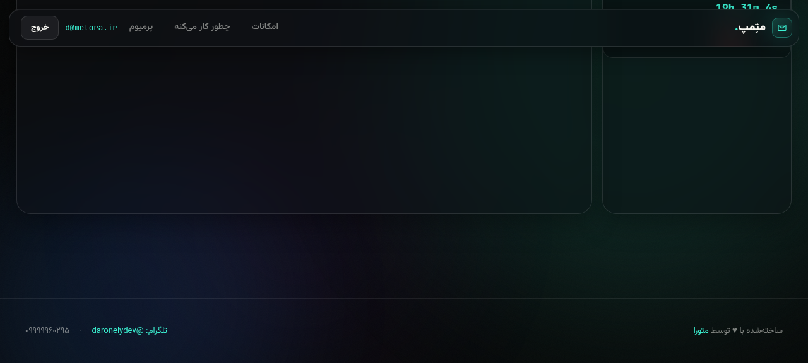
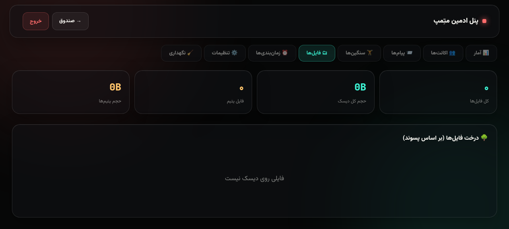
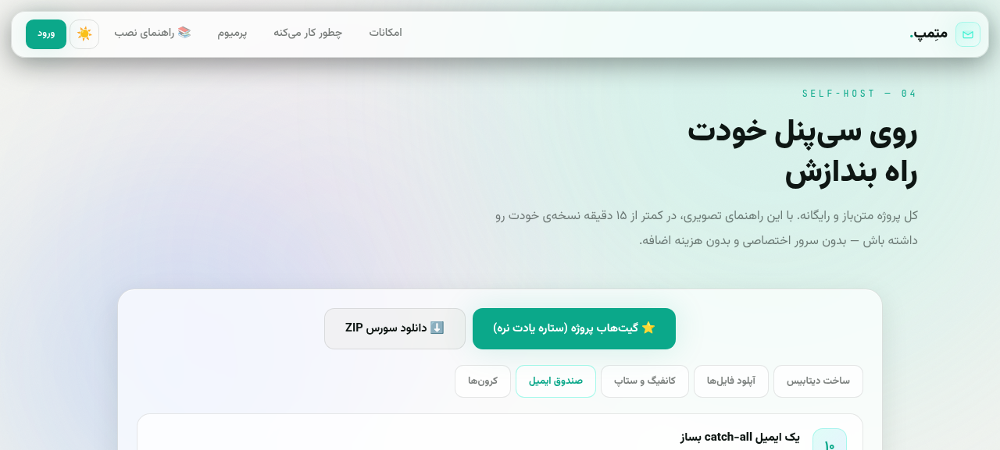
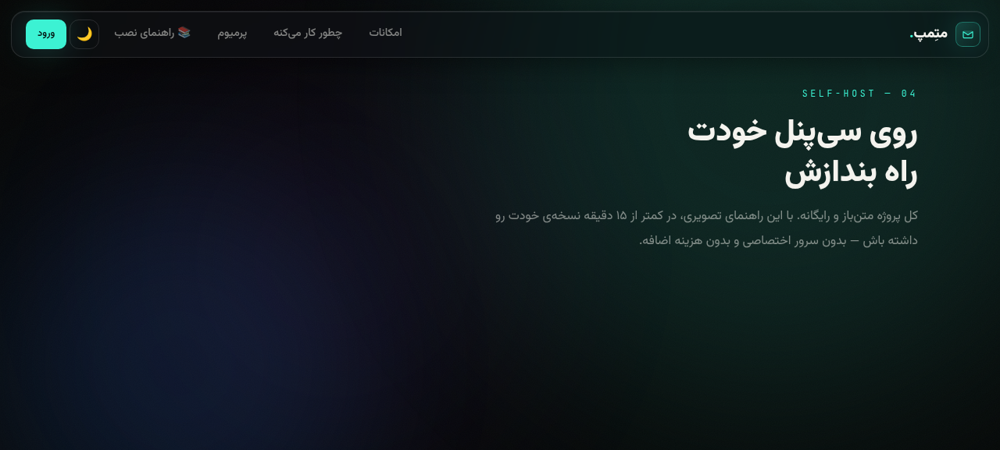
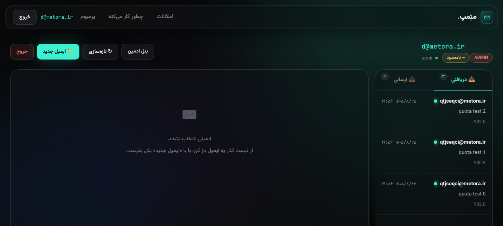

<div align="center">


# ⚡ Metora TempMail

**Одноразовая почта, которая действительно работает** — отправка, получение, вложения, отложенная отправка. Без спама, без хлопот.

[](https://temp.metora.ir)


🌐 **Русский** · **[English](README.md)** · **[فارسی](README.fa.md)**

*Полноценный сервис одноразовой почты на обычном виртуальном хостинге cPanel — без выделенного сервера, без облаков, без фреймворков.*

**[🚀 Живое демо](https://temp.metora.ir)** · **[✨ Возможности](#-возможности)** · **[🎨 UI-эффекты](#-интерфейс-и-опыт)** · **[📦 Установка](#️-установка-на-cpanel-5-минут)**

</div>

---

## 🎯 Почему Metora?

| Возможность | Metora | Обычная временная почта |
|:---|:---:|:---:|
| Персональный адрес `@metora.ir` | ✅ | ✅ |
| **Реальная отправка** писем | ✅ | ❌ |
| Реальное получение (полный MIME) | ✅ | ✅ |
| Вложения до 2 МБ | ✅ | некоторые |
| **⏰ Отложенная отправка** | ✅ | ❌ |
| **🔑 Автоизвлечение OTP-кодов** | ✅ | ❌ |
| **🎨 Генератор адресов** | ✅ | ❌ |
| **📱 QR для переноса адреса** | ✅ | ❌ |
| **🌗 Тёмная / светлая тема** | ✅ | ❌ |
| **⭐ Избранное + фильтры** | ✅ | ❌ |
| **📤 Экспорт в EML** | ✅ | ❌ |
| **🎭 Случайная личность для тестов** | ✅ | ❌ |
| **🔔 Звук нового письма** | ✅ | ❌ |
| Ответ с цитированием | ✅ | ❌ |
| Автоочистка каждые 6 часов | ✅ | ❌ |
| **Админ-панель из 8 вкладок + живые квоты** | ✅ | ❌ |
| Персидский RTL-интерфейс с Particle Typography | ✅ | ❌ |

> 🧹 **Философия:** ничего не остаётся. Каждые 6 часов все ящики очищаются — выживают только адрес и пароль. Не заходите 10 дней — и аккаунт исчезнет полностью.

---

## ✨ Возможности

### 👤 Для пользователей
- **Регистрация за 10 секунд** — без телефона, капчи и подтверждений
- **Полноценный клиент** — Входящие/Отправленные со счётчиками, ответ с цитатой, скачивание вложений, drag & drop
- **⏰ Отложенная отправка** — напишите сейчас, выберите дату, письмо уйдёт само; живой обратный отсчёт + кнопка отмены
  - одно письмо в день · максимум 5 ожидающих · вложение ≤ 1 МБ · время по Тегерану
- **Живой счётчик квоты** — всегда видно, сколько отправок осталось
- **🎨 Генератор адресов** — введите имя или бросьте 🎲 кубик, выберите домен из доступных, получите надёжный пароль и займите адрес мгновенно
- **🔑 Автоизвлечение OTP** — коды подтверждения из 4–8 цифр в непрочитанных письмах распознаются автоматически и показываются в **большой светящейся карточке** с кнопкой копирования (письмо не помечается прочитанным)
- **📱 QR-код** — перенесите адрес на телефон одним сканированием
- **⚡ Автообновление** — видимый переключатель опроса ящика каждые 10 секунд
- **🔔 Звуковое уведомление** — мягкий сигнал WebAudio при новом письме (отключаемый)
- **🌗 Тёмная/светлая тема** — один клик, выбор сохраняется в браузере
- **⏳ Таймер цикла** — живой обратный отсчёт до следующего 6-часового сброса
- **⭐ Избранное** — звёздочки (хранятся локально) + фильтры: все / избранное / непрочитанные / с вложениями
- **📤 Экспорт EML** — скачайте любое письмо в стандартном `.eml` (открывается в Outlook/Thunderbird)
- **🎭 Случайная личность** — имя, телефон, адрес, индекс… для тестирования форм, копируется в буфер одним кликом
- **📚 Наглядное руководство установки** — 15 шагов со скриншотами прямо на сайте («Руководство»)
- **📣 Рекламные места** — 4 резервируемых слота через Telegram

### 👑 Для админов (панель из 8 вкладок)
| Вкладка | Возможности |
|:---|:---|
| 📊 Статистика | аккаунты, письма, файлы-сироты, размер БД |
| 👥 Аккаунты | выдача/снятие премиума, удаление |
| 📨 Письма | просмотр и удаление любого письма |
| 🏋️ **Тяжёлые** | фильтрация больших писем по типу вложения (картинки/видео/аудио/PDF/ZIP) |
| 🗂 **Файлы** | дерево файлов по расширениям с полосами занятости, метками сирот, массовое удаление |
| ⏰ **Отложенные** | просмотр и удаление отложенных писем всех пользователей |
| ⚙️ Настройки | **редактирование всех квот в реальном времени** + добавление/снятие админов + смена пароля |
| 🧹 Обслуживание | 4 сброса + **умная очистка по типу контента** (все картинки/видео/аудио/документы/архивы/только текстовые) |

---

## 🎨 Интерфейс и опыт

| Эффект | Что делает |
|:---|:---|
| **🪐 Particle Typography v2** | заголовок собран из **тысяч чётких неоновых частиц** — в покое буквы идеально читаются и светятся; проведите курсором — они разлетаются и плавно возвращаются на место |
| **✨ Particle Typing** | искры вспыхивают вокруг курсора при наборе текста |
| **🧲 Магнитные кнопки** | кнопки притягиваются к курсору |
| **📝 Word Reveal** | заголовки появляются слово за словом с размытием при скролле |
| **🌊 Liquid Glass** | весь интерфейс — матовое стекло с неоновой окантовкой |
| **☄️ Aurora + Grain** | три дрейфующих световых пятна + кинематографичное зерно |
| **⌨️ Живой тайпер + отсчёт** | чип в хиро печатает примеры адресов; отложенные письма и истечение цикла тикают каждую секунду |
| **🌗 Двойная тема** | весь интерфейс в неоново-тёмном или минимально-светлом исполнении, выбор сохраняется |

Все эффекты уважают `prefers-reduced-motion` и протестированы на **390 / 768 / 1440px** — без горизонтального переполнения.

<div align="center">
<table><tr>
<td></td>
<td></td>
</tr><tr>
<td align="center"><sub>⏰ Отложенная отправка с обратным отсчётом</sub></td>
<td align="center"><sub>🗂 Дерево файлов админа</sub></td>
</tr><tr>
<td></td>
<td></td>
</tr><tr>
<td align="center"><sub>🎨 Генератор адресов</sub></td>
<td align="center"><sub>🔑 Карточка автоизвлечённого OTP</sub></td>
</tr><tr>
<td></td>
<td></td>
</tr><tr>
<td align="center"><sub>🌗 Светлая тема</sub></td>
<td align="center"><sub>📱 Перенос адреса по QR</sub></td>
</tr><tr>
<td></td>
<td></td>
</tr><tr>
<td align="center"><sub>📚 Наглядное руководство установки (15 шагов)</sub></td>
<td align="center"><sub>Полноценный клиент с панелью v4</sub></td>
</tr></table>
</div>

---

## 🏗️ Архитектура

```
Внешняя почта ──▶ MX (Exim) ──catch-all──▶ IMAP-опрос (каждую минуту) ──▶ MySQL
                                                                             ▲
SPA в браузере ◀──── REST API (PHP) ◀───────────────────────────────────────┘
                     │
                     ├── send.php      (мгновенная отправка + квоты)
                     ├── schedule.php  (отложенная отправка + правила)
                     └── admin.php     (8 разделов управления)

Cron:  * * * * *   imap_poll + process_scheduled
       0 */6 * * * reset_cycle      (очистка раз в 6 часов)
       30 3 * * *  purge_inactive   (аккаунты старше 10 дней)
```

| Путь | Назначение |
|:---|:---|
| `/` | одностраничное приложение (лендинг + клиент + отложенная отправка) |
| `/api/schedule.php` | создание/список/отмена отложенных со всеми правилами |
| `/cron/process_scheduled.php` | каждую минуту: отправка наступивших писем (защита GET_LOCK) |
| `/api/admin.php` | 20+ действий управления |

---

## 🛠️ Установка на cPanel (15 минут — со скриншотами)

> 💡 **Полное наглядное руководство из 15 шагов есть прямо на сайте:** [temp.metora.ir/#guide](https://temp.metora.ir/#guide)

1. **Загрузите** репозиторий в docroot поддомена
2. **Создайте базу данных и пользователя** (cPanel → MySQL® Databases, все привилегии)
3. **Настройте**: скопируйте `includes/config.sample.php` → `config.php` и заполните
4. **Создайте catch-all ящик** и направьте на него Default Address
5. **Откройте `setup.php` один раз**, затем **удалите его**
6. **Cron-задачи**:
   ```
   * * * * *           php -q .../cron/imap_poll.php
   * * * * *           php -q .../cron/process_scheduled.php
   0 0,6,12,18 * * *   php -q .../cron/reset_cycle.php
   30 3 * * *          php -q .../cron/purge_inactive.php
   ```
7. Войдите с сид-админом, задайте пароль и квоты в ⚙️ Настройках

> 🔐 `config.php` в `.gitignore`; `.htaccess` закрывает прямой доступ к `includes/`, `storage/`, `cron/`.

---

## 📊 Квоты (по умолчанию — все редактируются из панели)

| | Бесплатно | Премиум | Админ |
|:---|:---:|:---:|:---:|
| Отправок / цикл 6ч | 10 | 100 | **∞** |
| Размер входящих | 50 | 500 | **∞** |
| Вложений / письмо | 1 | 5 | 10 |
| Макс. вложение | 2 МБ | 2 МБ | 2 МБ |

---

## 🛡️ Безопасность

bcrypt+pepper · подготовленные выражения везде · сессии HttpOnly/SameSite · вложения вне docroot со случайными именами · скачивание только владельцем · полная валидация ввода · GET_LOCK на cron-задачах

---

## 🤝 Поддержка

**Telegram:** [@daronelydev](https://t.me/daronelydev)

## 📄 Лицензия

MIT — форкайте свободно, но не спамьте 🙂

<div align="center">
<sub>Сделано с ♥ <a href="https://github.com/Daronely">Daronely</a> под эгидой <a href="https://metora.ir">Metora</a></sub>
</div>


---

## 🆕 Версия 6.2

- **Движок прямой SMTP-доставки**: письма уходят прямо на MX получателя (STARTTLS + автоматический plaintext-fallback) — отправка работает даже на shared-хостингах, где очередь exim «зависает».
- **Админ-панель на трёх языках** (EN / فارси / RU), 183 переведённые строки, полный RTL.
- **Раздел тарифов** полностью синхронизирован на всех трёх языках.
- Тексты главной страницы переписаны и стали заметно убедительнее.
- Главный README репозитория теперь английский; это его русская версия.
